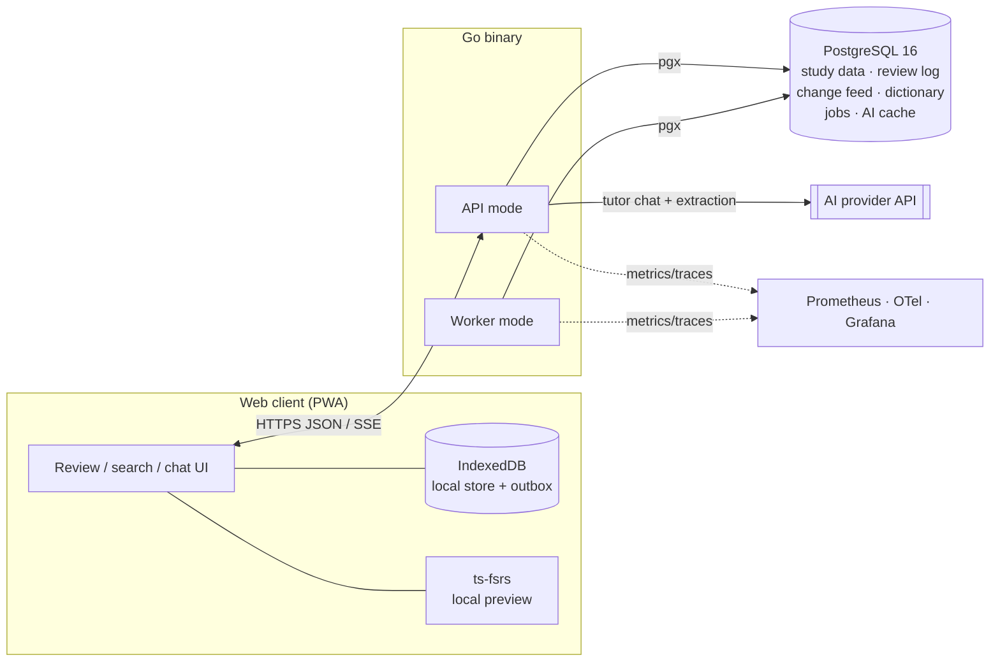

# Fuxi — System Design

| | |
|---|---|
| **Status** | v2.0, for review |
| **Last updated** | 28 November 2026 |
| **Companion doc** | [`PRD.md`](./PRD.md) |

This document describes *how* Fuxi is built. The PRD describes *what* it does and *why*. Section numbers here are referenced from code comments and ADRs, so keep them stable when editing.

---

## 1. Overview

Fuxi is a **modular monolith**: a single Go binary that runs in one of three modes.

| Mode | Command | Responsibility |
|---|---|---|
| API | `fuxi api` | HTTP JSON API, SSE streaming for the AI tutor |
| Worker | `fuxi worker` | Background jobs: imports, FSRS tuning, compaction, rollups |
| Migrate | `fuxi migrate up` | Applies database migrations; runs as a release step |

PostgreSQL is the only stateful dependency in v1. The AI provider (Anthropic in v1; others or a self-hosted model later) is an external HTTP dependency behind an interface.



### 1.1 Principles
1. **The review log is the source of truth.** Card scheduling state is derived and can always be rebuilt (§6).
2. **Every write is idempotent.** Clients generate ids; retries are safe (§7, §10).
3. **The dictionary is the source of truth for facts; the AI is the tutor.** AI output never becomes card data without passing through dictionary lookup (§8).
4. **Postgres first.** No Redis or Kafka until a measurement shows they're needed. Jobs, cache and change feed all live in Postgres.
5. **Time is injected.** No business logic calls `time.Now()` directly; a `Clock` is passed in. This makes scheduling, replay and tests deterministic.

## 2. Repository layout

```
fuxi/
├── cmd/fuxi/              # main.go: api | worker | migrate subcommands
├── internal/
│   ├── platform/          # db pool, config, clock, hlc, httpx helpers, logging, otel
│   ├── identity/          # users, devices, auth, tokens
│   ├── dictionary/        # entries, sentences, search, importers
│   ├── study/             # decks, notes, cards, review submission, due queue
│   ├── scheduling/        # FSRS wrapper, replay, parameter tuning
│   ├── sync/              # HLC, push, pull, snapshot, compaction
│   ├── tutor/             # AI provider interface, tools, agent loop, cache, budgets
│   ├── inbox/             # suggestions from the tutor and extraction
│   ├── learner/           # vocabulary check, word knowledge, learner level
│   ├── jobs/              # queue, worker loop, job handlers
│   └── stats/             # retention, forecast, rollups
├── db/
│   ├── migrations/        # goose SQL migrations (never edit after merge)
│   └── queries/           # sqlc query files, one per package
├── web/                   # Vite + TypeScript PWA
├── prompts/               # versioned system prompts and tool descriptions
├── evals/                 # tutor evaluation set and runner
├── deploy/                # docker-compose.yml, Dockerfile, grafana dashboards
├── docs/
│   ├── PRD.md
│   ├── SYSTEM_DESIGN.md
│   └── adr/               # 0001-modular-monolith.md, …
├── CLAUDE.md
└── README.md
```

Package rule: packages under `internal/` talk to each other through small Go interfaces, never through each other's tables. Only the owning package queries its tables.

## 3. Technology stack

| Layer | Choice | Reason |
|---|---|---|
| Language | Go | go-fsrs (MIT) available; single static binary; good concurrency for streaming |
| HTTP | `net/http` with `chi` | Small and idiomatic |
| API contract | OpenAPI 3.1 in `docs/openapi.yaml` | Validated in CI; client types generated from it |
| DB access | `pgx/v5` + `sqlc` | Type-safe Go generated from hand-written SQL |
| Migrations | `goose` | Plain SQL, versioned |
| Database | PostgreSQL 16 + `pg_trgm` | Trigram search, JSONB, `SKIP LOCKED`, partial indexes |
| Jobs | Small in-house queue on Postgres (River is the alternative) | Enqueue in the same transaction as the data |
| Scheduling | `github.com/open-spaced-repetition/go-fsrs` | Maintained FSRS implementation |
| AI | Anthropic API for v1, behind a provider interface | Same provider as the owner's Discord bot; the interface keeps OpenAI, Gemini or a self-hosted model possible (§8.12) |
| Client | Vite + TypeScript PWA, Dexie (IndexedDB), `ts-fsrs` | Offline-capable, minimal |
| Tests | `go test`, `testcontainers-go`, `pgregory.net/rapid` | Real Postgres in tests; property-based sync tests |
| Observability | `log/slog`, Prometheus client, OpenTelemetry | Standard signals |
| Deploy | Docker Compose everywhere: locally, and in production on one Oracle Cloud Always Free Arm VM behind a Cloudflare Tunnel (ADR-0020); AWS (ECS Fargate + RDS) optional later | Free, no inbound ports, and the same Compose file in development and production |
| CI | GitHub Actions | Lint, test, OpenAPI check, build, deploy on tag |

## 4. Data model

Ids for anything a client can create are **UUIDv7**, generated on the client, so objects created offline already have their final id. Timestamps are `timestamptz` in UTC. HLC values are stored as `text` in a sortable fixed-width format (§7.3).

### 4.1 Identity

Sign-in is delegated to Cloudflare Access (ADR-0018), so Fuxi stores no passwords, refresh tokens or invite codes. A user row is created the first time a verified Access token arrives for a new email (§12.1).

```sql
CREATE TABLE users (
    id              uuid PRIMARY KEY,                -- server-generated UUIDv7
    email           citext UNIQUE NOT NULL,          -- from the Access token
    timezone        text NOT NULL DEFAULT 'Asia/Jakarta',
    day_starts_at   smallint NOT NULL DEFAULT 4 CHECK (day_starts_at BETWEEN 0 AND 23),
    sync_seq        bigint NOT NULL DEFAULT 0,       -- per-user change counter (§7)
    role            text NOT NULL DEFAULT 'member',  -- member | owner
    settings        jsonb NOT NULL DEFAULT '{"explanation_language": "en", "tone_colours": false}',
    created_at      timestamptz NOT NULL,
    last_seen_at    timestamptz NOT NULL             -- updated at most hourly
);

CREATE TABLE devices (
    id               uuid PRIMARY KEY,               -- client-generated UUIDv7, kept by the PWA
    user_id          uuid NOT NULL REFERENCES users(id),
    name             text NOT NULL,
    last_pulled_seq  bigint NOT NULL DEFAULT 0,
    last_seen_at     timestamptz NOT NULL,
    created_at       timestamptz NOT NULL
);
```

### 4.2 Content (shared, read-only to users)

```sql
CREATE TABLE dict_entries (
    id               bigserial PRIMARY KEY,
    source           text NOT NULL,                 -- 'cedict'
    source_key       text NOT NULL,                 -- 'trad|simp|pinyin', stable across imports
    simplified       text NOT NULL,
    traditional      text NOT NULL,
    pinyin_numbered  text NOT NULL,                 -- 'ci2 dian3'
    pinyin_marked    text NOT NULL,                 -- 'cídiǎn'
    pinyin_toneless  text NOT NULL,                 -- 'cidian'
    definitions      text[] NOT NULL,
    secondary        boolean NOT NULL DEFAULT false, -- name or pointer entry ("variant of …"); ranks lower (§10)
    hsk_level        smallint,
    frequency_rank   integer,
    search_en        tsvector GENERATED ALWAYS AS   -- via an IMMUTABLE wrapper: array_to_string is only STABLE
                       (to_tsvector('english', array_to_string(definitions, ' '))) STORED,
    UNIQUE (source, source_key)
);
CREATE INDEX dict_simplified_idx  ON dict_entries (simplified text_pattern_ops);
CREATE INDEX dict_traditional_idx ON dict_entries (traditional text_pattern_ops);
CREATE INDEX dict_toneless_trgm   ON dict_entries USING gin (pinyin_toneless gin_trgm_ops);
CREATE INDEX dict_en_fts          ON dict_entries USING gin (search_en);

CREATE TABLE sentences (
    id         bigserial PRIMARY KEY,
    source     text NOT NULL,                       -- 'tatoeba' | 'user' | 'ai'
    source_id  text,
    zh         text NOT NULL,
    en         text,
    trust      smallint NOT NULL DEFAULT 0,         -- -1 hidden, 0 unknown, 1 reviewed
    max_hsk    smallint,                            -- hardest word level, for level filtering
    UNIQUE (source, source_id)
);

CREATE TABLE sentence_words (
    sentence_id bigint NOT NULL REFERENCES sentences(id),
    entry_id    bigint NOT NULL REFERENCES dict_entries(id),
    PRIMARY KEY (entry_id, sentence_id)
);

CREATE TABLE import_runs (
    id            bigserial PRIMARY KEY,
    source        text NOT NULL,
    file_sha256   text NOT NULL UNIQUE,
    status        text NOT NULL,                    -- running | succeeded | failed
    rows_upserted integer,
    started_at    timestamptz NOT NULL DEFAULT now(),
    finished_at   timestamptz
);
```

### 4.3 Study (per user, synced)

```sql
CREATE TABLE decks (
    id           uuid PRIMARY KEY,
    user_id      uuid NOT NULL REFERENCES users(id),
    name         text NOT NULL,
    settings     jsonb NOT NULL,      -- new_per_day, card_types[], desired_retention, type_answers, unlock_days (§6.7)
    field_hlc    jsonb NOT NULL,      -- {"name": "<hlc>", "settings": "<hlc>"}
    deleted_hlc  text
);

CREATE TABLE notes (
    id           uuid PRIMARY KEY,
    user_id      uuid NOT NULL REFERENCES users(id),
    deck_id      uuid NOT NULL REFERENCES decks(id),
    entry_id     bigint REFERENCES dict_entries(id),   -- null for custom notes
    kind         text NOT NULL,                        -- 'word' | 'sentence'
    fields       jsonb NOT NULL,      -- {hanzi, pinyin, meaning, sentence, cloze, notes}
    tags         text[] NOT NULL DEFAULT '{}',
    origin       text NOT NULL,       -- 'search' | 'csv' | 'hsk' | 'tutor' | 'extract' | 'placement'
    field_hlc    jsonb NOT NULL,
    deleted_hlc  text
);

CREATE TABLE cards (
    id           uuid PRIMARY KEY,
    user_id      uuid NOT NULL REFERENCES users(id),
    note_id      uuid NOT NULL REFERENCES notes(id),
    card_type    text NOT NULL,       -- 'recognition' | 'recall' | 'tones' | 'cloze' | 'order' | 'translate' | 'use' (§6.7)
    suspended    boolean NOT NULL DEFAULT false,
    field_hlc    jsonb NOT NULL,
    deleted_hlc  text,
    UNIQUE (note_id, card_type)
);

-- Append-only source of truth. Never UPDATE or DELETE.
CREATE TABLE review_logs (
    id           uuid PRIMARY KEY,               -- client-generated: idempotency key
    user_id      uuid NOT NULL REFERENCES users(id),
    card_id      uuid NOT NULL REFERENCES cards(id),
    rating       smallint NOT NULL CHECK (rating BETWEEN 1 AND 4),
    reviewed_at  timestamptz NOT NULL,            -- device time of the review
    duration_ms  integer,
    device_id    uuid NOT NULL,
    exercise     jsonb,                           -- the answer and its check, for exercises (§6.7); null for self-rated cards
    received_at  timestamptz NOT NULL DEFAULT now()
);
CREATE INDEX review_logs_card_idx ON review_logs (card_id, reviewed_at, id);
CREATE INDEX review_logs_user_idx ON review_logs (user_id, reviewed_at);

-- Derived cache: a pure function of (review_logs for the card, fsrs params version).
-- One row per live card, created with the card (state new); deleting the card
-- deletes the row, since the log can always rebuild it.
CREATE TABLE card_states (
    card_id          uuid PRIMARY KEY REFERENCES cards(id),
    user_id          uuid NOT NULL,
    deck_id          uuid NOT NULL,           -- denormalised from notes for the queue
    state            smallint NOT NULL,       -- 0 new | 1 learning | 2 review | 3 relearning
    due_at           timestamptz NOT NULL,
    stability        double precision NOT NULL,
    difficulty       double precision NOT NULL,
    reps             integer NOT NULL,
    lapses           integer NOT NULL,
    remaining_steps  integer NOT NULL DEFAULT 0,  -- learning steps left (go-fsrs v4)
    last_review_at   timestamptz,
    first_review_at  timestamptz,                 -- when it stopped being new (§6.3)
    params_version   integer NOT NULL,
    suspended        boolean NOT NULL DEFAULT false   -- denormalised from cards for the queue index
);
CREATE INDEX card_states_due_idx ON card_states (user_id, due_at) WHERE NOT suspended AND state <> 0;
CREATE INDEX card_states_new_idx ON card_states (user_id, deck_id) WHERE NOT suspended AND state = 0;
CREATE INDEX card_states_introduced_idx ON card_states (user_id, deck_id, first_review_at);

CREATE TABLE fsrs_params (
    user_id             uuid NOT NULL REFERENCES users(id),
    version             integer NOT NULL,
    weights             double precision[] NOT NULL,
    trained_on_reviews  integer NOT NULL,
    created_at          timestamptz NOT NULL DEFAULT now(),
    PRIMARY KEY (user_id, version)
);
```

Decks, notes and cards also carry `created_at`. Card ids are UUIDv5 of `(note_id, card_type)`, so every device derives the same id offline. Until M5 the server writes `field_hlc` and `deleted_hlc` itself, as the only HLC node. Deleting a deck or note sets `deleted_hlc` on it and its cards (ADR-0006); review logs are kept.

### 4.4 Sync

```sql
CREATE TABLE changes (
    user_id      uuid NOT NULL,
    seq          bigint NOT NULL,
    entity_type  text NOT NULL,         -- deck | note | card | review | card_state | word_knowledge
    entity_id    uuid NOT NULL,
    op           text NOT NULL,         -- upsert | delete
    payload      jsonb NOT NULL,        -- full current entity after the change
    hlc          text,
    device_id    uuid,
    created_at   timestamptz NOT NULL DEFAULT now(),
    PRIMARY KEY (user_id, seq)
);

CREATE TABLE applied_ops (
    user_id  uuid NOT NULL,
    op_id    uuid NOT NULL,
    seq      bigint,                    -- the change it produced, if any
    PRIMARY KEY (user_id, op_id)
);
```

### 4.5 AI tutor and inbox

```sql
CREATE TABLE conversations (
    id          uuid PRIMARY KEY,
    user_id     uuid NOT NULL REFERENCES users(id),
    title       text,
    context     jsonb,                  -- e.g. {"card_id": "..."} when opened from a review
    created_at  timestamptz NOT NULL DEFAULT now(),
    updated_at  timestamptz NOT NULL DEFAULT now()
);

CREATE TABLE messages (
    id              uuid PRIMARY KEY,   -- client-generated for user messages
    conversation_id uuid NOT NULL REFERENCES conversations(id),
    role            text NOT NULL,      -- user | assistant | tool
    content         jsonb NOT NULL,     -- text blocks, tool calls, tool results, word chips
    model           text,
    prompt_version  text,
    input_tokens    integer,
    output_tokens   integer,
    cost_micros     bigint,             -- cost in millionths of a US dollar
    latency_ms      integer,
    created_at      timestamptz NOT NULL DEFAULT now()
);
CREATE INDEX messages_conv_idx ON messages (conversation_id, created_at);

CREATE TABLE ai_cache (
    key          bytea PRIMARY KEY,     -- sha256(prompt_version | model | language | normalised request), §8.8
    response     jsonb NOT NULL,
    hits         integer NOT NULL DEFAULT 0,
    created_at   timestamptz NOT NULL DEFAULT now(),
    expires_at   timestamptz NOT NULL
);

CREATE TABLE ai_usage_daily (
    user_id        uuid NOT NULL,
    day            date NOT NULL,
    requests       integer NOT NULL DEFAULT 0,
    input_tokens   bigint NOT NULL DEFAULT 0,
    output_tokens  bigint NOT NULL DEFAULT 0,
    cost_micros    bigint NOT NULL DEFAULT 0,
    PRIMARY KEY (user_id, day)
);

CREATE TABLE inbox_items (
    id               uuid PRIMARY KEY,
    user_id          uuid NOT NULL REFERENCES users(id),
    entry_id         bigint NOT NULL REFERENCES dict_entries(id),
    source           text NOT NULL,     -- 'tutor' | 'extract' | 'auto_capture'
    conversation_id  uuid REFERENCES conversations(id),
    reason           text,              -- short note from the AI: "used in your homework"
    status           text NOT NULL DEFAULT 'pending',  -- pending | accepted | dismissed
    created_at       timestamptz NOT NULL DEFAULT now()
);
CREATE UNIQUE INDEX inbox_pending_uniq ON inbox_items (user_id, entry_id) WHERE status = 'pending';
```

### 4.6 Learner level and vocabulary check

```sql
CREATE TABLE learner_profiles (
    user_id              uuid PRIMARY KEY REFERENCES users(id),
    band_scheme          text NOT NULL DEFAULT 'hsk3',   -- 'hsk3' (7 bands: 1–6 and 7–9) | 'hsk2' (6 levels)
    band_estimates       jsonb NOT NULL,                 -- {"1": 0.95, "2": 0.80, "3": 0.35, …}
    assumed_known_bands  smallint[] NOT NULL DEFAULT '{}',
    vocab_estimate       integer,
    level                numeric(3,1),                   -- e.g. 2.6
    source               text NOT NULL,                  -- placement | manual | recomputed
    updated_at           timestamptz NOT NULL DEFAULT now()
);

-- What the user knows about individual words. Synced (§7.1).
CREATE TABLE word_knowledge (
    id          uuid PRIMARY KEY,            -- UUIDv5(user_id, entry_id): identical on every device
    user_id     uuid NOT NULL REFERENCES users(id),
    entry_id    bigint NOT NULL REFERENCES dict_entries(id),
    status      text NOT NULL,               -- known | learning | unknown
    source      text NOT NULL,               -- placement | manual | review
    confidence  real NOT NULL,
    field_hlc   jsonb NOT NULL,
    updated_at  timestamptz NOT NULL DEFAULT now(),
    UNIQUE (user_id, entry_id)
);

CREATE TABLE pseudo_words (
    id    serial PRIMARY KEY,
    text  text NOT NULL UNIQUE,              -- made-up word built from real characters
    band  smallint NOT NULL                  -- band of its component characters
);

CREATE TABLE placement_sessions (
    id           uuid PRIMARY KEY,
    user_id      uuid NOT NULL REFERENCES users(id),
    self_report  text,                       -- never | lt_6m | 6_12m | 1_2y | gt_2y
    status       text NOT NULL DEFAULT 'in_progress',   -- in_progress | completed | abandoned
    word_cap     smallint NOT NULL DEFAULT 30,           -- 60 after "Sharpen my estimate"
    state        jsonb NOT NULL,             -- current band, per-band tallies, RNG seed
    result       jsonb,                      -- final estimates (§9.4)
    started_at   timestamptz NOT NULL DEFAULT now(),
    finished_at  timestamptz
);

CREATE TABLE placement_items (
    session_id   uuid NOT NULL REFERENCES placement_sessions(id),
    seq          smallint NOT NULL,
    screen       smallint NOT NULL,          -- grid screen number (5 words per screen)
    slot         smallint,                   -- position on the screen (null for meaning questions)
    kind         text NOT NULL,              -- word | pseudo | meaning_check
    entry_id     bigint REFERENCES dict_entries(id),
    pseudo_id    integer REFERENCES pseudo_words(id),
    band         smallint NOT NULL,
    options      jsonb,                      -- meaning-check choices; the key stays server-side
    answer       text,                       -- tapped | not_tapped | correct | wrong
    answered_at  timestamptz,
    PRIMARY KEY (session_id, seq)
);
```

### 4.7 Jobs

```sql
CREATE TABLE jobs (
    id            bigserial PRIMARY KEY,
    kind          text NOT NULL,
    user_id       uuid REFERENCES users(id),        -- owner of a user-started job (GET /jobs/{id})
    payload       jsonb NOT NULL,
    status        text NOT NULL DEFAULT 'queued',   -- queued | running | succeeded | failed | dead
    run_at        timestamptz NOT NULL DEFAULT now(),
    attempts      integer NOT NULL DEFAULT 0,
    max_attempts  integer NOT NULL DEFAULT 5,
    locked_until  timestamptz,
    last_error    text,
    result        jsonb,                             -- handler output, e.g. rows imported
    dedupe_key    text UNIQUE,                       -- optional: prevents duplicate enqueues
    created_at    timestamptz NOT NULL,
    finished_at   timestamptz
);
CREATE INDEX jobs_ready_idx ON jobs (run_at) WHERE status = 'queued';
```

## 5. Content pipeline

Sources: **CC-CEDICT** (CC BY-SA), **Tatoeba** (CC BY 2.0 FR), **HSK 3.0 examination syllabus word list** (published November 2025, in force for exams from 2026): `corpus/syllabus2025/syllabus2025_words.tsv` from [harukicoder/hsk30](https://github.com/harukicoder/hsk30), MIT, pinned to a commit in `Taskfile.yml`. It is extracted from the official PDF and validated against the syllabus's own entry counts. Note that the 2021 grading standard (GF 0025-2021), which most open "HSK 3.0" lists encode, places about 40% of shared words at a different level; Fuxi uses the exam syllabus. All are downloaded snapshots; nothing is scraped. `task data:download` fetches them and `task data:import` loads them (`fuxi import cedict|hsk|tatoeba`, in that order).

1. **Pin.** The importer computes the file's SHA-256. If `import_runs` already has it, stop.
2. **Parse.** CC-CEDICT line → traditional, simplified, numbered pinyin, definitions. Convert to tone marks (`chuan2` → `chuán`, `lu:4` → `lǜ`) and toneless (`chuan`) forms.
3. **Stage and upsert.** `COPY` into an unlogged staging table, then `INSERT … ON CONFLICT (source, source_key) DO UPDATE` in one transaction.
4. **Link sentences.** Segment each Tatoeba sentence by greedy longest match against the dictionary (simplified and traditional forms, since Tatoeba has both). When a headword has several entries, an ordinary entry beats a name or pointer entry, then the lowest HSK level wins. Fill `sentence_words`, and compute `max_hsk` (names and pointer entries are ignored; a word on no HSK list makes it `NULL`). Until a word-frequency list is chosen, `frequency_rank` is the number of sentences using the entry, ranked. Linking reruns after both the HSK and Tatoeba imports.
5. **Tag levels.** Apply the HSK 3.0 syllabus to set `hsk_level` (1–6, or 7 for the combined 7–9 band). Each listed reading tags ordinary entries with the same tone-marked pinyin (吗 *ma*, not *má*); failing that, the same toneless pinyin (the syllabus writes tone sandhi: 一下 *yíxià*); failing that, every entry for the word. A reading listed twice keeps the lowest level. Words on no list keep `hsk_level = NULL` and are never used in the vocabulary check. With the pinned list, 10,894 of 10,896 syllabus words match a CC-CEDICT entry.

User data only references `dict_entries.id`, and `source_key` is stable, so re-imports never orphan notes.

## 6. Scheduling

### 6.1 FSRS wrapper
```go
type Scheduler interface {
    // Next returns the card state after a review. Pure function: no clock, no I/O.
    Next(prev CardState, rating Rating, reviewedAt time.Time, p Params) CardState
    // Replay folds an ordered list of reviews into a state.
    Replay(reviews []Review, p Params) CardState
}
```
- Implemented on top of go-fsrs v4 (`internal/scheduling`). Fuzz is disabled (v4's default), so output is deterministic. Times are rounded to microseconds, Postgres's precision, so a state read back from `card_states` equals the one computed in memory.
- `Replay` is a fold over `Next`, ordered by `(reviewed_at, id)`.

### 6.2 Submitting a review (online)
In one transaction:
1. `INSERT INTO review_logs … ON CONFLICT (id) DO NOTHING`. If no row was inserted, return the current state (an idempotent retry).
2. Load the current `card_states` row `FOR UPDATE`.
3. If `reviewed_at >= last_review_at`, apply `Next`. Otherwise load the card's whole log and `Replay` (a late offline review).
4. Upsert `card_states`; append a `changes` row (§7.4).

### 6.3 Due queue
```sql
SELECT cs.card_id, cs.due_at
FROM card_states cs
WHERE cs.user_id = $1
  AND NOT cs.suspended
  AND cs.due_at < $2          -- end of the user's current study day (§6.4)
ORDER BY cs.due_at
LIMIT $3;
```
Cards in state new are excluded above. New cards are added up to each deck's `new_per_day` minus new cards already introduced today, counted from `card_states.first_review_at` since the start of the study day; they come oldest note first, recognition before recall. The exercise types tones, cloze, order, translate and use are *gated*: a new card of those types is eligible only once the note's recognition card is in state review with an interval of at least the deck's `unlock_days` for that type (§6.7), and the AI-checked types also need the daily AI exercise allowance (§8.13). Gated cards count toward `new_per_day` like any other new card.

"Due today" includes cards whose time falls later in the study day. The client treats new and review cards as ready all day, since an FSRS interval of a day or more means "some time today", while learning and relearning cards wait until their step is up (within a minute). Home shows the cards ready now, and counts learning cards that come back later today separately (`web/src/lib/queue.ts`).

Each queued card carries `preview`: its due time for each of the four ratings if rated now, computed with the same weights and deck retention as a real review, so the rating buttons can show their intervals without a second FSRS implementation in the client (until M5 brings `ts-fsrs` for offline review).

### 6.4 Study day
`day_start = local date at day_starts_at:00 in users.timezone`, converted to UTC per request. Store everything in UTC. Tests cover timezone changes and DST transitions (a study day can be 23 or 25 hours). The binary embeds the time zone database (`time/tzdata`), since the distroless image has none.

### 6.5 Personalised parameters (worker job `fsrs.tune`)
Runs nightly for users with at least about 1,000 reviews and at least 200 new ones since the last tune. It fits FSRS weights on the user's log, stores a new `fsrs_params` version, then enqueues `fsrs.rebuild` jobs that recompute `card_states` in batches of 1,000 cards. The FSRS optimiser is most mature in the Python and Rust ecosystems, so this job may shell out to a small Python script. Check what Go offers at implementation time.

### 6.6 Home summary
`GET /study/summary` returns, for the current study day, the due and remaining new counts per deck (the same rules as §6.3), and reviews per study day for the last 7 days, oldest first. Each review is assigned the local date of `reviewed_at` moved back by `day_starts_at` hours, so a review at 1 am counts for the evening before. A day with at least one review earns its seal on the home screen.

### 6.7 Exercises
Self-rated cards ask "do you remember this?". Exercises check an answer instead (PRD §8.7). Every type is a card of its note with its own FSRS state, so each skill is scheduled on its own: a word can be easy to recognise and still hard to use.

| Card type | Prompt | Answer | Checked by | Introduced when |
|---|---|---|---|---|
| `recognition` | Hanzi | Self-rated | — | From the start |
| `recall` | Meaning | Self-rated, or typed when the deck's `type_answers` is on (default) | App: hanzi, or pinyin with marks or numbers | From the start |
| `tones` | Hanzi | A tone for each syllable | App: the entry's pinyin (any reading of a 多音字) | Recognition interval ≥ 7 days |
| `cloze` | A sentence with the word blanked | Typed, or one of four choices | App: the word | ≥ 7 days |
| `order` | The sentence's words, shuffled | Tapped in order | App: the original sentence | ≥ 7 days |
| `translate` | An English sentence at the learner's level | Written in Chinese | AI (§8.13) | ≥ 21 days |
| `use` | The word | The learner's own sentence | AI (§8.13) | ≥ 21 days |

The day thresholds are `unlock_days` in deck settings. Which types a deck creates is `card_types` (PRD R6); recognition and recall are on by default and the exercise types are opt-in per deck until M3.5 has had real use.

**Content.** The queue (§6.3) attaches an `exercise` object to exercise cards: the kind, the Tatoeba sentence id and text, the shuffled tokens (from the §5 segmenter) or the four choices, and the expected answer. The client checks app-checked answers itself, so they will work offline in M5. Sentences come from `internal/dictionary` through a small interface (`Sentences(entryID, maxHSK)`): simplified script only, containing the word, 4–14 segmented tokens for `order`, mostly within the learner's level. The pick is seeded by `(card_id, reps)`, so reloading the queue shows the same sentence and the next review shows a different one. Cloze distractors are other words from the user's decks in the same HSK band and with a similar length, never synonyms the dictionary lists for the word.

**Checking.** Pinyin answers are normalised before comparing (tone numbers to marks, spaces and case ignored, `v` as `ü`). A wrong answer shows the expected one and suggests Again. A right one suggests Good, or Hard when it took more than twice the median time for that card type. The learner confirms the suggestion or picks another rating, and only that rating reaches FSRS (ADR-0019): the scheduler never sees the verdict.

**Storing.** `POST /reviews` carries an optional `exercise` object, stored in `review_logs.exercise`: `{kind, sentence_id?, answer, correct, suggested_rating, checker: "app" | "ai" | "self", grade_id?}`. The log stays append-only; the field is informational and never read by `Replay`. It lets M6 report how often suggestions were overridden, per card type.

## 7. Offline-first sync

### 7.1 Two kinds of data
| Kind | Tables | Merge rule |
|---|---|---|
| Append-only events | `review_logs` | Union by id; duplicates dropped by primary key |
| Mutable entities | `decks`, `notes`, `cards`, `word_knowledge` | Field-level last-writer-wins by HLC; deletes are sticky tombstones |
| Not synced | `conversations`, `messages`, `inbox_items`, `placement_*`, `learner_profiles` | Online-only (PRD FR-S-3) |

`word_knowledge` ids are **UUIDv5 of (user_id, entry_id)** rather than random. If two offline devices both mark 认识 as known, they generate the same id, so the server sees two edits to one row instead of two conflicting rows.

### 7.2 Why not trust device clocks
Phone clocks drift and can be set by hand. Ordering edits by wall-clock time would let a phone with a fast clock overwrite newer edits forever.

### 7.3 Hybrid logical clock
Format: `{wall_ms:013d}:{counter:05d}:{device_id_short}`. It is fixed width, so string comparison equals logical comparison.
- **Local event:** `wall = max(last.wall, now)`; `counter = (wall == last.wall) ? last.counter + 1 : 0`.
- **Receive:** merge with the max of local, remote and now, using the same counter rule.
- The server rejects HLCs more than 24 hours ahead of server time, to protect against a badly wrong clock.

### 7.4 Push

```
POST /v1/sync/push
{
  "device_id": "0192…",
  "ops": [
    {"op_id": "0192…", "type": "note.update", "entity_id": "…",
     "fields": {"meaning": "dictionary"}, "hlc": "1728640000000:00000:a1b2"},
    {"op_id": "0192…", "type": "review.create", "review": {"id": "…", "card_id": "…",
     "rating": 3, "reviewed_at": "2026-10-12T01:02:03Z", "duration_ms": 4100}}
  ]
}
```

Server, in one transaction:
1. `SELECT sync_seq FROM users WHERE id = $1 FOR UPDATE`. This serialises pushes **per user**; different users never block each other.
2. Drop ops whose `op_id` is already in `applied_ops`.
3. Apply each op:
   - `review.create` → §6.2 steps 1–3.
   - `*.update` → for each field, write only if `incoming_hlc > field_hlc[field]`; update `field_hlc`.
   - `*.delete` → set `deleted_hlc` if it's not already set (sticky).
4. Append one `changes` row per resulting entity change, with `seq = sync_seq + 1, +2, …`
5. Record `applied_ops`, update `users.sync_seq`, commit.
6. Respond `{applied: [...], skipped: [...], server_seq: N}`.

> **Why not one global `bigserial` for `seq`?** Transaction A gets 101 and B gets 102, but B commits first. A client pulling at that moment sees 102, sets its cursor to 102, and never receives 101 once A commits. Locking the user row makes per-user sequence order equal commit order. Recorded in ADR-0004.

### 7.5 Pull and snapshot
- `GET /v1/sync/pull?since=40&limit=500` → `{changes: [...], next: 540, has_more: true}`
- The client applies a page **and** advances its cursor in the same IndexedDB transaction.
- Client loop: push outbox → pull until `has_more = false`.
- `GET /v1/sync/snapshot` → full current state at `seq = N`, for new devices or after compaction.
- Compaction job: delete `changes` older than 90 days. A pull with `since` below the horizon returns `410 Gone`, and the client re-bootstraps from a snapshot.

### 7.6 Conflict table
| Scenario | Result |
|---|---|
| Same card reviewed offline on two devices | Both reviews kept; card state replayed in `(reviewed_at, id)` order |
| Same note edited on two devices | Per field, the later HLC wins |
| Edit on one device, delete on another | Delete wins; restoring is an explicit new op |
| Push retried after timeout | Known `op_id`s skipped; identical response |
| Review for a card deleted elsewhere | Review stored; card stays deleted |

### 7.7 Testing
- **Property-based (rapid):** N simulated devices perform random ops, then push and pull in random order with duplicated and dropped responses. Assert: (a) all replicas converge to identical state; (b) every review ever created exists exactly once.
- **Concurrency integration test:** 20 goroutines push for the same user against real Postgres. Assert that `changes.seq` has no gaps and no duplicates.

## 8. AI tutor

### 8.1 Responsibilities
| Capability | Endpoint | Model use |
|---|---|---|
| Chat about words and grammar | `POST /v1/tutor/conversations/{id}/messages` (SSE) | Tool-calling agent loop |
| Check a translation or the learner's own sentence | `POST /v1/exercises/grade` (§8.13) | Single call with structured JSON output |
| Extract words from pasted text | `POST /v1/tutor/extract` | Single call with structured JSON output |
| "Ask about this" from a review | Same as chat, conversation created with `context.card_id` | Preloaded context |

### 8.2 Provider abstraction
```go
type Provider interface {
    // Stream runs one model turn and emits text deltas and tool-call requests.
    Stream(ctx context.Context, req Request) (<-chan Event, error)
    Name() string
}

type Request struct {
    Model       string
    System      string
    Messages    []Message
    Tools       []ToolSpec          // JSON Schema for each tool's input
    MaxTokens   int
    JSONSchema  *json.RawMessage    // set for structured output (extraction)
}

type Event struct {
    Kind      EventKind  // TextDelta | ToolCall | Done | Error
    Text      string
    ToolCall  *ToolCall
    Usage     *Usage     // set on Done
}
```
Adapters: `anthropic`, `openai`, `gemini`, plus a `fake` provider with scripted responses for tests. The model name per capability comes from config. Chat uses a stronger model; extraction can use a cheaper one. v1 ships with the `anthropic` adapter (hosted, token-billed). An `openai_compatible` adapter for self-hosted models is planned but not required for v1 (§8.12).

**Keep the interface portable.** Business logic may rely only on what every serious provider and local server offers: streaming text, tool calls with JSON-Schema arguments, and JSON-structured output. Provider-specific extras (such as server-side prompt caching) stay inside an adapter and must be optional, so switching to a self-hosted model never touches tutor logic.

### 8.3 Tools exposed to the model
All tools are **read-only, except `suggest_words`, which only writes to the Inbox**. The model can never create, edit or delete decks, notes or cards (PRD FR-AI-4).

| Tool | Input | Returns |
|---|---|---|
| `search_dictionary` | `{query: string, limit?: int}` | Entries: id, simplified, traditional, pinyin_marked, definitions, hsk_level |
| `get_examples` | `{entry_id: int, max_hsk?: int, limit?: int}` | Tatoeba sentences containing the word, filtered by level |
| `check_known_words` | `{words: string[]}` | For each word: known, learning or unknown, and why (§9.6) |
| `get_learner_profile` | `{}` | Level and per-band estimates (§9), vocabulary estimate, a sample of recently learned words |
| `suggest_words` | `{entry_ids: int[], reason: string}` | Creates pending `inbox_items`; returns ids. Used only for bulk suggestions; words the user taps on a chip go straight to a deck through the normal notes API, not through the model. |

Every tool runs with the authenticated `user_id` taken from the request context, never from model output.

### 8.4 Agent loop
```
messages = history + user message
for step in 1..MAX_STEPS (5):
    stream model turn
        forward TextDelta events to the client over SSE
        collect ToolCall events
    if no tool calls: break
    validate tool args against JSON Schema → run tools (with timeout) → append tool results
emit final "chips" event: every dictionary entry referenced in this turn
persist assistant + tool messages, usage, cost
```
- **Cancellation:** if the client disconnects, the request context is cancelled, which cancels the upstream model call.
- **Timeouts:** 30 seconds per model turn, 3 seconds per tool, 60 seconds overall.
- **Word chips:** built from the entries returned by `search_dictionary` during the turn, plus a final pass that finds hanzi runs in the answer and resolves them against the dictionary. Chips always carry dictionary data, never model text.

### 8.5 SSE event stream
```
event: text        data: {"delta": "Both mean \"to know\", but "}
event: tool        data: {"name": "search_dictionary", "status": "running"}
event: text        data: {"delta": "知道 (zhīdào) is …"}
event: chips       data: {"entries": [{"id": 123, "simplified": "知道", "pinyin": "zhīdào", "in_deck": false}]}
event: done        data: {"message_id": "…", "usage": {"input_tokens": 812, "output_tokens": 240}}
```

### 8.6 Extraction (structured output)
Request: `{text, deck_id?}`. The model returns JSON matching:
```json
{"words": [{"text": "认识", "reason": "core verb, HSK 1"}], "unparsed": []}
```
Server post-processing:
1. Resolve each `text` against `dict_entries` (exact simplified, then traditional).
2. Unresolved strings go to `unparsed` and never become cards (PRD FR-AI-9).
3. Drop words the user already knows or is learning (§9.6).
4. Return candidates with dictionary data. The client shows a checklist.

### 8.7 Prompts and grounding
- System prompts live in `prompts/` as versioned files (`tutor.v3.md`). The version is stored on every message.
- Rules in the prompt: call `search_dictionary` before stating pinyin or meanings; prefer `get_examples`; when writing original sentences, use mostly known words from `get_learner_profile`; suggest words at the learner's level or one band above, most frequent first; mark original sentences as AI-written; stay on Mandarin learning.
- AI-written sentences shown to the user are saved to `sentences` with `source = 'ai'` and are visibly labelled.
- **Explanation language:** the system prompt tells the model to explain in the user's `settings.explanation_language` (`en` or `id`, PRD C1). Chinese text, pinyin and dictionary definitions are never translated.

### 8.8 Caching
- Key = `sha256(prompt_version | model | explanation_language | normalised_request)`, where normalisation lowercases, trims and collapses whitespace. The language is part of the key, so an Indonesian answer is never served to someone who asked for English.
- Caching applies only to **first-turn, context-free questions** ("explain 把") and extraction. Multi-turn conversations aren't cached.
- TTL is 30 days. A cache hit is still logged as a message with `cost_micros = 0`.

### 8.9 Budgets and rate limits
- Per-user daily budget in `ai_usage_daily`, checked before each call and incremented atomically after.
- A global monthly cost cap is checked from a cached aggregate. When exceeded, the tutor returns `503` with a friendly message.
- Per-user token bucket: at most 10 tutor requests per minute.

### 8.10 Evaluation
`evals/` holds a set of about 50 cases: words with known pinyin and meaning, confusable pairs, and grammar questions with expected key points. `task eval` runs them against the configured model and prompt version and reports:
- the pinyin error rate (checked against CC-CEDICT),
- tool-use rate (did it look words up?),
- latency and cost.

A second set of about 40 grading cases (§8.13) pairs exercises with answers and the expected verdict: correct sentences in several valid word orders, common learner errors (word order, missing 了 or 的, wrong measure word, the word used with the wrong meaning) and off-task answers. `task eval` reports agreement with the expected verdicts, and how often a correct answer is marked wrong, which matters most because it would push a learner to Again.

Run it before changing prompts or models; results are committed to `evals/results/`.

### 8.11 Privacy
Sent to the provider: the conversation, tool results, and a learner profile (level and a sample of words). Never sent: email, user id, device information. Provider API keys are server-side only.

### 8.12 Self-hosted models (future option)
v1 uses a hosted, token-billed API. Self-hosting an open-weight model stays possible, and is worth revisiting if friends' usage makes the bill grow.

- **How:** run an open model (the Qwen family is the natural fit for Chinese and tool calling) with Ollama, llama.cpp or vLLM. All three expose an OpenAI-compatible HTTP API, so one `openai_compatible` adapter with a configurable `base_url` and model name covers them.
- **Mixing is allowed:** the model is configured per capability, so extraction could run on a small local model while chat stays hosted.
- **Adjustments for local models:** longer timeouts (local generation is slower); grammar-constrained or JSON mode for extraction, because smaller models break structured output more often; avoid models under about 8B parameters for the tool-calling chat loop.
- **Hosting choices:** the owner's own machine (free per token, but only available while it's on; needs a private tunnel such as Tailscale to reach it from a phone); a rented GPU server (fixed monthly cost, usually only worth it at real volume); or a pay-per-second GPU service (cheap when idle, but cold starts hurt chat latency). The app's own server has no GPU and can't run a useful model.
- **Deciding:** run the eval set (§8.10) against the candidate local model and the hosted one, and compare pinyin error rate, tool-use rate, latency and cost per question from `messages.cost_micros`. Switch only if the local model meets the PRD targets. Record the result as an ADR.

### 8.13 Grading answers
`POST /v1/exercises/grade` checks a `translate` or `use` answer: `{card_id, answer, sentence_id?}` → `{grade_id, verdict, corrected, explanation, suggested_rating}`. It is one model call with structured output, not the agent loop: the prompt already carries what grading needs (the note's dictionary entry, the English sentence and its Tatoeba Chinese for `translate`, the learner's level), so no tools are offered.

- **Verdicts:** `correct` (natural and uses the word as asked) → Good; `minor` (understandable with a small error) → Hard; `wrong` (ungrammatical, wrong meaning or the word not used) → Again. The AI never suggests Easy; the learner can still choose it.
- **Output:** the corrected sentence (equal to the answer when correct) and a two- or three-sentence explanation in the user's explanation language. Both are shown labelled AI-generated (PRD FR-AI-5) and are never written to notes or cards (ADR-0009). Pinyin is not generated; if the explanation names a word, it is resolved against the dictionary like chips (§8.4).
- **Storing:** each call is a row in `exercise_grades` (user_id, card_id, answer, response, model, prompt_version, cost_micros, created_at), owned by the tutor package; the review that follows references it by `grade_id`.
- **Limits:** grading counts toward the daily AI budget (§8.9) and a separate allowance, `users.settings.ai_exercises_per_day` (default 5). The queue leaves out AI-checked cards once the allowance is used, and the client leaves them out while offline; they stay due for another day. Answers are unique, so grading isn't cached (§8.8).
- **Failure:** on a timeout, a provider error or invalid output, the client shows "Couldn't check this one" and offers the four ratings as a self-rated card; the review then has `checker: "self"`.
- **Evaluation:** the grading cases in §8.10.

## 9. Vocabulary check and learner level

### 9.1 Purpose
Estimate what a new user already knows in **about a minute** (PRD V1–V10, FR-V-1…9), then keep that estimate current. The result does three things: it stops known words becoming cards, it drives the tutor's level targeting, and it picks starter decks.

The check is a **yes/no vocabulary test in a tap-the-words grid**, with checks for over-claiming. Yes/no tests are a well-established format for estimating vocabulary size. The grid trades a little precision for speed (ADR-0013), and the level keeps correcting itself from real study afterwards (§9.7). Full item-response-theory models are a possible later upgrade (ADR-0011).

### 9.2 Item bank
- **Real words:** `dict_entries` grouped by `hsk_level` (the band). With HSK 3.0 there are 7 bands: levels 1–6, plus levels 7–9 as one band, because the official list doesn't split them. Within a band, items are sampled across frequency quartiles, so the check doesn't only show a band's easiest words.
- **Pseudo-words:** about 300 two-character strings built from common characters. A one-off script generates candidates that are not CC-CEDICT entries and do not appear in a word-frequency list. They are then reviewed by hand to remove accidental real words or unfortunate combinations, and stored in `pseudo_words`.
- **Meaning-question options:** the word's first definition plus three distractor definitions from other entries in the same band.

### 9.3 Procedure
1. **Start band** from the self-report: never or under 6 months → band 1; 6–12 months → 2; 1–2 years → 3; over 2 years → 4. (These are HSK 3.0 levels.)
2. **One screen = 5 words** from the current band, in random positions. About every other screen, one of the five is a pseudo-word from that band.
3. **The instruction reads:** *"Tap the words you recognise, even if you're not 100% sure."* This matters: in simulation, how many known words a cautious learner skips is the biggest driver of accuracy (§9.9).
4. **After Next**, some tapped words get a four-choice meaning question, one per screen:
   - each tapped real word with probability 0.3, and at least once per band visited;
   - tapped pseudo-words with the same probability, with four made-up meanings, purely as camouflage (the answer is ignored).
5. **Score each real word:** tapped and not contradicted = 1; not tapped, or failed its meaning question = 0.
6. **After each screen**, look at the current band's rate, corrected for over-claiming (the `k_b` formula in §9.4, using the false-alarm rate so far):
   - 0.8 or higher → move up one band.
   - 0.4 or lower → move down one band.
   - Otherwise stay: this band is near the learner's edge, so more samples sharpen the estimate.
7. **Stop** when any of these is true:
   - **Boundary found:** band *b* has at least 6 answers with a corrected rate of 0.7 or more, and band *b + 1* has at least 6 answers below 0.7. (Hitting the top or bottom band also counts.)
   - **30 words** have been shown (6 screens).
   - The user taps **Finish now**.
8. **Sharpen my estimate** (optional, on the result screen) resumes the same session, with a cap of 60 words and a boundary requirement of 10 answers per band.

The session's `state` (current band, tallies, RNG seed) is saved after every screen. A check can therefore resume after a crash or a closed tab, and the sequence of words is reproducible in tests.

### 9.4 Scoring
For each tested band *b*:

- `h_b` = the share of the band's real words scored 1.
- `f` = the **false-alarm rate**: tapped pseudo-words ÷ pseudo-words shown, across the whole check. If fewer than 3 pseudo-words were shown, use a prior of `f = 0.05`. Cap `f` at 0.9.
- `k_b = max(0, (h_b − f) / (1 − f))` is the corrected share known. This is the standard correction for guessing in yes/no tests.

Then:
- **Untested bands** below the lowest tested band get `max(k_lowest, 0.9)`. Untested bands above the highest get `min(k_highest, 0.1)`.
- **Monotonic smoothing:** a higher band can never score above a lower one, so `k_b = min(k_b, k_{b−1})`.
- **Vocabulary estimate** = Σ `k_b × |band b|`.
- **Level** = `b* + k_{b*+1}`, where `b*` is the highest band with `k ≥ 0.7`. For example, a learner solid through HSK 2 who knows 60% of HSK 3 is level 2.6.
- With fewer than 15 words answered (an early Finish now), the result is labelled "rough estimate".

### 9.5 Applying the result
- **Answered words:**
  - Scored 1 → `word_knowledge` known, `source = placement`, `confidence = 0.8`.
  - Not tapped → `word_knowledge` unknown, `source = placement`, `confidence = 0.5`. The low confidence reflects that cautious learners skip some words they know.
  - Failed a meaning question → unknown, `confidence = 0.9`.
- **Whole bands:** bands with `k_b ≥ 0.9` go into `learner_profiles.assumed_known_bands`. Their words are treated as known without writing thousands of rows (§9.6).
- **Verify later** (PRD V5): for each word marked known, create a note and a recognition card with a seeded FSRS state: review state, stability of about 30 days, due dates spread across days 21–35 so they don't all land on one day. go-fsrs accepts a hand-built `Card` value, so no fake reviews are needed.

### 9.6 Deciding whether a word is known
Every feature asks the same question through one function, answered with one batched SQL query:

```go
// Knowledge reports how the user stands on each entry, in priority order:
// direct evidence beats assumptions.
func (s *Service) Knowledge(ctx context.Context, userID uuid.UUID, entryIDs []int64) (map[int64]Knowledge, error)
```

1. **A recognition card exists that has been reviewed at least once and isn't suspended:** known if its stability is at least 21 days and its last rating wasn't Again; otherwise learning. (Suspended and never-reviewed cards fall through to rule 2, so "I already know this" on a new card works.)
2. **A `word_knowledge` row exists:** use its status.
3. **The word's band is in `assumed_known_bands`:** known (assumed).
4. **Otherwise:** unknown.

Callers: tutor tools (`check_known_words`, `get_learner_profile`), extraction (§8.6), starter-deck generation, and suggestion ranking.

### 9.7 Keeping the level current
The check is a starting estimate. These rules correct it, in both directions, as real evidence arrives:

- **On review:** if a word marked known by the check gets rated **Again**, its `word_knowledge` row flips to learning inside the same review transaction (PRD FR-V-7).
- **On "I already know this":** writes a `word_knowledge` row with `source = manual` and suspends any not-yet-reviewed card for that word, in one transaction (`internal/learner` asks `internal/study` to suspend the cards inside its transaction). Undoing it deletes the row and brings those cards back; a never-reviewed card the user had suspended by hand comes back too, since the reason for a suspension isn't recorded. Offline, both changes go into the outbox together and are pushed in one batch. This is the main way an underestimated learner corrects upwards: every too-easy suggestion they dismiss raises their level.
- **Nightly job `learner.recompute`** (also run right after a check completes) re-scores every band. The check's result acts as a prior worth as many observations as the check actually showed in that band, between 5 and 20, so it fades as real evidence builds up:

  `k_b = (n_b × observed_b + w_b × placement_b) / (n_b + w_b)`

  Here `n_b` is the number of band-*b* words with direct evidence since the check (card states, manual `word_knowledge` rows), `observed_b` is the share of those known, and `w_b` is the prior weight. A short check therefore carries less weight than a sharpened one.

### 9.8 API
| Endpoint | Purpose |
|---|---|
| `POST /v1/placement/sessions {self_report}` | Start a check; returns the session id and the first screen |
| `POST /v1/placement/sessions/{id}/screens/{n} {tapped: [slot…]}` | Submit a screen; returns its meaning questions, then the next screen or the result. Idempotent on `(session_id, n)` |
| `POST /v1/placement/sessions/{id}/questions/{seq} {choice}` | Answer a meaning question. Idempotent on `(session_id, seq)` |
| `POST /v1/placement/sessions/{id}/finish` | Finish now |
| `POST /v1/placement/sessions/{id}/sharpen` | Continue for up to 30 more words (§9.3 step 8) |
| `POST /v1/placement/sessions/{id}/apply {mode}` | `mark_known` or `verify_later` |
| `GET /v1/learner/profile` | Level, per-band estimates, vocabulary estimate |
| `PUT /v1/learner/profile/level {band}` | Set the level by hand (skip the check) |
| `PUT /v1/knowledge/{entry_id} {status}` | "I already know this" (also available as a sync op). M3 accepts `known` only |
| `DELETE /v1/knowledge/{entry_id}` | Undo "I already know this" |
| `GET /v1/knowledge?entry_ids=` | The user's rows for up to 200 entries (M3; `Knowledge()` arrives in M4) |

A screen sent to the client contains only slot numbers and the text to show; a meaning question contains only its text and four options. Neither reveals whether an item is a pseudo-word, or which option is correct. The server keeps the key.

### 9.9 Testing with simulated learners
A Go test runs the real procedure against synthetic learners:
- Each synthetic learner has a true known-probability per band, for example `[1.0, 0.95, 0.6, 0.2, 0.05, 0]`.
- There are three behaviour profiles:
  - **honest** taps words they know, plus 3% of pseudo-words;
  - **over-claimer** also taps 30% of words they don't know, pseudo-words included;
  - **cautious** skips 25% of words they actually know.
- 1,000 runs per profile, with fixed seeds.

It asserts:
- **Accuracy:** the estimated level is within ±0.5 of the true level in at least 80% of honest runs and at least 70% of over-claimer runs.
- **Safe direction:** for cautious learners, at most 5% of runs **over**estimate by more than 0.5. Underestimates are allowed, because §9.7 corrects them.
- **Length:** no default check shows more than 30 words; with Sharpen, no more than 60.

**Prototype results** from `scripts/placement_sim.py` (1,000 runs per profile; times assume about 6 seconds per screen and 5 seconds per meaning question). Percentages are runs within ±0.5 of the true level:

| Version | Honest | Over-claimer | Cautious | Median time |
|---|---|---|---|---|
| **Default, 30 words, HSK 3.0 (7 bands)** | **82%** | **74%** | 38%, with 0% overestimated | **about 1 minute** |
| Sharpen, up to 60 words, HSK 3.0 | 88% | 75% | 36%, with 0% overestimated | about 1¾–2 minutes |
| Default, 30 words, HSK 2.0 (6 bands), for comparison | 85% | 74% | 42%, with 1% overestimated | about 1 minute |
| Previous one-word-at-a-time design, HSK 2.0, up to 60 words (with "Not sure") | 90% | 80% | 87% | about 3 minutes (estimated) |

Cautious accuracy depends on how many known words they skip (HSK 2.0 runs): 25% skipped gives 42%, 15% gives 65%, 10% gives 71%, 5% gives 81%. This is why the instruction in §9.3 step 3 matters. Asking meaning questions about untapped words was also tried; it raised cautious accuracy only to about 49% and added time, so it isn't used.

The Go test should reproduce these numbers, and the measured results go in the README. This test is also the tool for tuning thresholds such as 0.8, 0.4 and 0.7.

## 10. API

Base path `/v1`. JSON; errors use RFC 9457 `application/problem+json`. Cursor pagination everywhere.

| Group | Endpoints |
|---|---|
| Sign-in | Cloudflare Access in front of the app (ADR-0018); sign out at `/cdn-cgi/access/logout` |
| Account | `GET /me` · `PATCH /me/settings` (explanation language, tone colours, timezone, day start) · `GET /devices` · `PUT /devices/{id}` · `DELETE /devices/{id}` |
| Dictionary | `GET /dict/search?q=` · `GET /dict/entries/{id}` |
| Decks | `GET /decks` · `POST /decks` · `GET /decks/{id}` · `PATCH /decks/{id}` · `DELETE /decks/{id}` |
| Notes and cards | `GET /decks/{id}/notes?after=` · `POST /decks/{id}/notes` · `GET /notes?entry_id=` · `GET /notes/{id}` · `PATCH /notes/{id}` · `DELETE /notes/{id}` · `PATCH /cards/{id} {suspended}` |
| Imports | `POST /decks/{id}/import?import_id=` (body: the CSV) → `202 {job_id}` · `GET /jobs/{id}` |
| Study | `GET /study/queue?deck=` (cards carry rating previews, §6.3, and exercise content, §6.7) · `GET /study/summary` (§6.6) · `POST /reviews` (with `exercise` for exercises) · `POST /exercises/grade` (AI-checked exercises, §8.13) |
| Inbox | `GET /inbox` · `POST /inbox/{id}/accept {deck_id}` · `POST /inbox/{id}/dismiss` · `POST /inbox/accept-all {deck_id}` |
| Tutor | `POST /tutor/conversations` · `GET /tutor/conversations` · `GET /tutor/conversations/{id}` · `POST /tutor/conversations/{id}/messages` (SSE) · `POST /tutor/extract` |
| Sync | `POST /sync/push` · `GET /sync/pull?since=` · `GET /sync/snapshot` |
| Placement & level | See §9.8; `word_knowledge` endpoints from M3 |
| Web client | Everything outside `/v1`, `/healthz` and `/readyz` is the PWA, served by API mode from `FUXI_WEB_DIR` on the same origin, so one Access application covers app and API. Hashed assets are cached for a year; `index.html`, the service worker and the manifest are revalidated on every load |
| Stats | `GET /stats/summary` · `GET /stats/forecast?days=30` |
| Ops | `GET /healthz` · `GET /readyz` · `GET /metrics` (internal) |

**Search routing:** input containing hanzi → prefix match on simplified or traditional; if nothing matches, the phrase is split into the dictionary words it contains (the §5 step 4 segmenter, cached in memory and rebuilt after an import) and the response carries `"segmented": true`, so 我喜欢 returns 我, 喜欢. ASCII with tone digits (`ma3`) → numbered pinyin. Plain ASCII → trigram match on toneless pinyin, unioned with English full-text search. Ranking: exact match, then ordinary words before names and pointer entries not on the HSK list, then HSK level, then frequency.

## 11. Background jobs

| Kind | Trigger | Notes |
|---|---|---|
| `import.dataset` | CLI / admin | §5 |
| `import.csv` | `POST /decks/{id}/import` | Validates rows; creates notes and cards in batches of 500 |
| `fsrs.tune` / `fsrs.rebuild` | Nightly | §6.5 |
| `sync.compact` | Nightly | §7.5 |
| `stats.rollup` | Nightly | Daily aggregates per user |
| `ai_cache.expire` | Nightly | Deletes expired rows |
| `learner.recompute` | Nightly, and after each check | §9.7 |
| `placement.abandon` | Hourly | Marks checks idle for 24 hours as abandoned (a result is still produced from the screens answered) |

**Worker loop:**
```sql
UPDATE jobs SET status = 'running', attempts = attempts + 1,
                locked_until = now() + interval '5 minutes'
WHERE id = (
    SELECT id FROM jobs
    WHERE status = 'queued' AND run_at <= now()
    ORDER BY run_at
    FOR UPDATE SKIP LOCKED
    LIMIT 1)
RETURNING *;
```
On failure: `run_at = now() + backoff(attempts)`, with exponential backoff and jitter. After `max_attempts` the job becomes `dead`. A reaper requeues `running` jobs whose `locked_until` has passed (the worker crashed). Handlers must be idempotent.

## 12. Cross-cutting concerns

### 12.1 Security
- **Sign-in through Cloudflare Access (ADR-0018).** Every `/v1` request except the dictionary must carry an Access JWT, which the API verifies itself: RS256 only, the team's published keys, issuer, audience (the application's AUD tag), expiry with one minute of leeway, and an email. A failed check is 401. `FUXI_AUTH=dev` replaces this with a fixed or header-supplied email for local development only.
- **Invite-only:** the Access policy's list of allowed emails is the invite list; it replaces invite codes (ADR-0015). A user row is created on the first verified request.
- **Owner view:** `fuxi usage` (CLI) prints AI usage and cost per account from `ai_usage_daily`, so the owner can see what friends' usage costs.
- Repository functions require a `userID` argument; there are no unscoped queries. Row-level security is a stretch goal.
- Limits: CSV up to 2 MB and 5,000 rows; push batch up to 500 ops; tutor message up to 4,000 characters; extraction text up to 10,000 characters.

### 12.2 Observability
- **Logs:** `slog` JSON with `request_id`, `user_id` (hashed) and `route`.
- **Metrics:**
  - `http_request_duration_seconds{route,code}`
  - `sync_push_ops_total`, `sync_pull_lag`
  - `jobs_queue_depth{kind}`, `jobs_oldest_age_seconds`
  - `scheduler_replays_total`
  - `placement_items_per_session`, `placement_duration_seconds`, `placement_false_alarm_rate`
  - `tutor_ttft_seconds` (time to first token), `tutor_tokens_total{model,direction}`, `tutor_cost_micros_total{model}`, `tutor_cache_hits_total`, `tutor_tool_calls_total{tool}`
- **Traces:** OpenTelemetry spans from HTTP through SQL, tools and provider calls.
- **Dashboards:** Grafana JSON committed in `deploy/grafana/`.

### 12.3 Testing
| Layer | Scope | Tools |
|---|---|---|
| Unit | Scheduler wrapper, pinyin conversion, HLC, search routing, tool arg validation | `go test`, table-driven |
| Integration | Repositories, push/pull, concurrent pushes, imports, agent loop with fake provider | `testcontainers-go` |
| Authorization | Every endpoint is called with a second user's token against the first user's data and must return 404 (never the data). A route without this test fails CI. | `go test` with a route registry check |
| Property | Sync convergence, no lost reviews | `rapid` |
| Simulation | Vocabulary check accuracy with synthetic learners (§9.9) | `go test`, seeded RNG |
| Eval | Tutor accuracy and cost | `evals/` runner |
| Load | Morning review burst, sync storm, tutor concurrency (fake provider) | k6 |

### 12.4 Performance targets (p95, server-side)
| Operation | Target | Setup |
|---|---|---|
| `POST /reviews` | < 50 ms | 1,000 users × 5,000 cards |
| `GET /study/queue` | < 100 ms | One user with 100,000 cards |
| `POST /sync/push` (200 ops) | < 200 ms | Including replays |
| `GET /dict/search` | < 80 ms | Full CC-CEDICT |
| Tutor time to first token | < 2 s | Real provider; excludes provider outages |

## 13. Deployment

- Multi-stage Dockerfile builds a distroless image with a single binary and the built PWA. Every base image is published for x86 and Arm, and the image is built on the machine that runs it.
- `deploy/docker-compose.yml` is the local stack (postgres, migrate, api, worker; prometheus and grafana join in M7). `task up` starts it (Task replaces make, ADR-0017).
- **Production (ADR-0020):** `deploy/production/compose.yml` on one machine: postgres, migrate, api, worker, backup and cloudflared, started with `task prod:up`. The first deploy ran on the owner's PC; the long-term home is an Oracle Cloud Always Free Arm VM (Ampere A1). The step-by-step guide is [`docs/DEPLOY.md`](./DEPLOY.md).
- **Network:** a Cloudflare Tunnel connects out from `cloudflared` to Cloudflare, and the public hostname `fuxi.<domain>` forwards to `http://api:8080` on the Compose network. No port is published publicly; the API's port is bound to loopback for checks on the machine. The API still verifies every Access token (§12.1).
- **Release:** `git pull` and `task prod:up`. Compose rebuilds the image, runs `fuxi migrate up` as a one-shot service, and starts the API and worker only after it succeeds; a few seconds of downtime are accepted.
- **Settings and secrets:** `deploy/production/.env`, never committed (`.env.example` lists every setting). Secrets are the tunnel token, the database password (hex, generated by `task prod:init`) and, from M4, AI provider keys. `FUXI_ACCESS_TEAM_DOMAIN` and `FUXI_ACCESS_AUD` are public identifiers kept there because they are deployment-specific; the signing keys are fetched from Cloudflare.
- **Datasets:** `task prod:import` runs the importers (§5) against the production database from a one-off container with the downloaded files mounted read-only.
- **Backups:** the `backup` service takes a compressed `pg_dump` at start-up and then daily, keeping 14 days, in `deploy/production/backups/`. Dumps must also be copied off the machine. `task prod:restore` restores one in a single transaction; a restore is tested once per milestone (first done on 28 November 2026: 125,412 entries and 89,289 sentences restored).

## 14. Milestones

Assumes about 8–10 hours per week.

| # | Milestone | Weeks | Scope | Done when |
|---|---|---|---|---|
| M0 | Foundations | 1 | Repo layout, Compose, migrations, CI, `/healthz`, ADR template | `task up` works; CI green |
| M1 | Content & search | 2 | CC-CEDICT / Tatoeba / HSK importers, pinyin utils, search API | "ma" → 妈 / 马 / 吗; re-import is a no-op |
| M2 | Study core | 2 | Sign-in (Cloudflare Access, ADR-0018), devices, decks, notes, cards, FSRS wrapper, reviews, due queue, study day, CSV import job | Full review session via API; replay test passes |
| M3 | Daily-usable client | 2 | Installable PWA: login, search, add, review, decks; `word_knowledge` + "I already know this"; first deploy | Owner studies with it daily |
| M3.5 | Practice | 2 | Exercises checked by the app (§6.7): typed answers on recall cards, tones, cloze and sentence-order cards, sentence selection from Tatoeba, gated introduction, suggested ratings, `review_logs.exercise`, card types per deck | A word moves from recognition to cloze and order as it matures; every exercise review stores its answer |
| M4 | Vocabulary check + AI tutor | 4.5 | Pseudo-word bank, tap-grid check, scoring, `Knowledge()` function, learner profile, simulation tests; provider interface + adapter, tools, agent loop, SSE, chips, extraction, Inbox, cache, budgets, eval set; AI-checked translate and use exercises (§8.13) | Simulation targets met (§9.9); ask → chip → card in under 5 s; eval pinyin errors < 2%; grading agreement ≥ 90% with no more than 5% of correct answers marked wrong |
| M5 | Offline sync | 3 | HLC, outbox, push/pull/snapshot, conflict rules, compaction, property tests | Convergence test passes thousands of runs; offline demo |
| M6 | Insight | 1.5 | Stats, forecast, FSRS tuning job | Retention chart; nightly tuning |
| M7 | Production polish | 1.5 | Dashboards, k6 load tests, rate limits, README, ADRs, demo video | Published numbers and write-up |

Total: about 19.5 weeks. Daily use begins after M3; exercises checked by the app follow in M3.5; the vocabulary check and tutor arrive together at M4, since the tutor is the main user of the learner level.

## 15. Architecture decision records

| ADR | Decision |
|---|---|
| 0001 | Modular monolith instead of microservices |
| 0002 | Postgres as the job queue, cache and change feed (no Redis or Kafka in v1) |
| 0003 | Review log as source of truth; card state as derived cache |
| 0004 | Per-user sync sequencing with a row lock, not a global sequence |
| 0005 | Hybrid logical clocks with field-level last-writer-wins |
| 0006 | Delete wins over concurrent edit (sticky tombstones) |
| 0007 | Go instead of Spring Boot |
| 0008 | AI tools are read-only except Inbox suggestions |
| 0009 | Dictionary is the source of truth for card data; AI text never becomes card fields |
| 0010 | Tutor conversations are online-only and excluded from sync |
| 0011 | Yes/no vocabulary check with over-claiming correction, instead of a full IRT model |
| 0012 | Deterministic UUIDv5 ids for `word_knowledge`, so concurrent offline marks merge |
| 0013 | Tap-the-words grid with a 30-word default: speed over precision; underestimates are accepted because later study corrects them |
| 0014 | Anthropic's hosted, token-billed API for v1; self-hosting kept possible through a portable provider interface (§8.12) |
| 0015 | Invite-only registration, so sharing with friends can't expose the AI budget to strangers (now enforced by the Access policy, ADR-0018) |
| 0016 | HSK 3.0 (2026 word-list revision) for levels, with 7–9 as one band |
| 0017 | Task instead of make for developer commands, so they work on Windows too |
| 0018 | Cloudflare Access for sign-in instead of passwords, refresh tokens and invite codes |
| 0019 | Checked answers suggest a rating and the learner confirms it; exercises unlock as a word matures |
| 0020 | One Oracle Cloud Arm VM running Docker Compose behind a Cloudflare Tunnel, instead of Fly.io |

Template: `docs/adr/0000-template.md` with the sections Context, Decision, Alternatives considered, Consequences.

## 16. Open technical questions
1. ~~Can go-fsrs's current version produce deterministic output with fuzz on, or must fuzz be disabled?~~ Decided: fuzz stays off (go-fsrs v4's default), §6.1.
2. Should the FSRS optimiser run in Go, as a Python sidecar script, or through a WASM build?
3. ~~Which repository has a clearly licensed HSK 3.0 word list?~~ Decided: the 2025 examination syllabus list from harukicoder/hsk30 (MIT), see §5. Fallback if it is withdrawn: bezlant/hsk-3-vocabulary (same syllabus, CC BY-SA 4.0).
4. Should conversation history be summarised after N turns to control token cost?
5. ~~HSK 2.0 or HSK 3.0?~~ Decided: HSK 3.0 (ADR-0016). The design stays band-agnostic, so a future revision only changes `band_scheme`, band sizes and the start-band mapping.
6. How many hand-reviewed pseudo-words are needed per band to keep the false-alarm estimate stable? The simulation in §9.9 can answer this.
7. How much do real learners skip words they know in the grid? Measure it on yourself first (Verify-later reviews show it) and re-tune the instruction text or thresholds.
8. At what monthly AI cost (or number of active friends) is it worth evaluating a self-hosted model (§8.12)?

## 17. References
- go-fsrs: https://github.com/open-spaced-repetition/go-fsrs
- FSRS overview: https://github.com/open-spaced-repetition/free-spaced-repetition-scheduler
- ts-fsrs: https://github.com/open-spaced-repetition/ts-fsrs
- CC-CEDICT: https://cc-cedict.org/wiki/
- Tatoeba downloads: https://tatoeba.org/en/downloads
- rapid: https://pkg.go.dev/pgregory.net/rapid
- testcontainers-go: https://golang.testcontainers.org
- River: https://riverqueue.com
- Kulkarni et al., "Logical Physical Clocks and Consistent Snapshots in Globally Distributed Databases" (2014)
